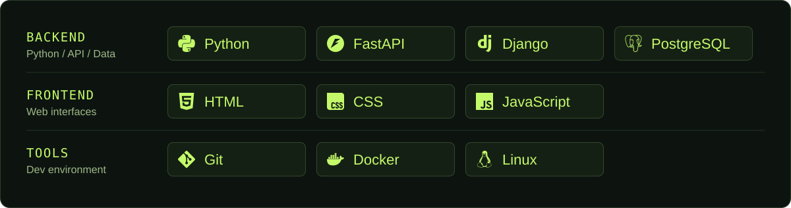

<picture></picture>

 

&nbsp;&nbsp;
&nbsp;&nbsp;
&nbsp;&nbsp;

 

<strong>Привет, я Никита.</strong>

Разрабатываю на **Python**: веб-сервисы, API, ботов и интеграции.
Работаю с данными и автоматизирую рутину.

- **Backend** — FastAPI, Django, REST и интеграции между сервисами.
- **Данные** — SQL, PostgreSQL, анализ и применение нейросетей.
- **Frontend** — создаю интерфейсы с помощью AI.

 

<strong>Стек</strong>

<picture></picture>
